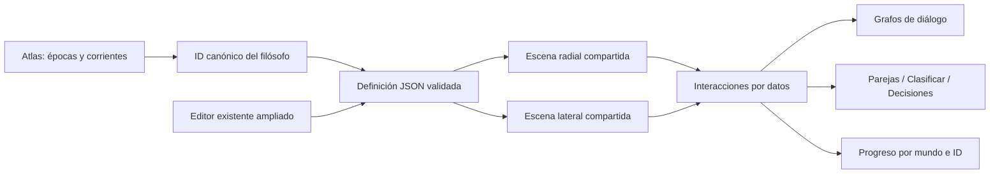

# Motor de mundos configurables

Esta arquitectura es una ampliación del juego existente. Conserva la Polis, su compañero, controles, editor y dos formatos anteriores de guardado.

## Separación de responsabilidades

- `src/worlds/schema.ts`: contrato y validación de recursos, objetos, destinos, grafos, actividades y recompensas. JSON nunca contiene código ejecutable.

- `src/worlds/catalog.ts`: galaxias históricas, corrientes, temas y planetas únicos por autor.

- `src/engine/progression.ts`: bloqueo inicial, cursor de conversación, respuestas, elecciones, argumentos y recompensas idempotentes.

- `src/engine/content-player.ts`: una interfaz compartida para cualquier autor. Parejas por selección; clasificación por arrastre o toque; decisiones con consecuencias y argumentación.

- `src/engine/universe.ts`: carga, atlas, acciones, tránsito a interiores, perfil de progreso y conexión con el editor.

- `src/engine/drafts.ts`: configuraciones y recursos importados en IndexedDB. Los cambios de contenido no se mezclan con las respuestas del jugador.

- `src/planet-scene.ts`: la misma escena recibe terreno, recursos, objetos y callbacks del mundo activo. Física, cámara y navegación no dependen del filósofo.

- `src/main.ts`: conserva la historia anterior y adapta su escena lateral a los interiores definidos en datos.

## Añadir un mundo

1. Investigar al autor y diseñar toda su geografía. Registrar las fuentes y distinguir las ampliaciones de las actividades terminadas.

2. Crear recursos gráficos coherentes. Usar rutas `assets/...png|webp|jpg` o importar imágenes en el editor; no usar SVG/HTML/JavaScript procedente de configuraciones.

3. Preparar una definición con `format: "sofia-world"`, `version: 1`, ID del mundo y del filósofo, recursos, superficie e interiores, interacciones, diálogos, actividades y descubrimientos. `public/worlds/sartre.json` es el ejemplo completo del formato.

4. Importarla desde el editor. Un autor nuevo se registra en su época y sus corrientes; dos rutas no crean dos copias de su planeta. La importación rechaza una segunda identidad de planeta para el mismo autor.

5. Arrastrar recursos a la superficie, ajustar apoyo/ángulo/escala, seleccionar el objeto y configurar su comportamiento. Los diálogos, minijuegos e interiores ya definidos aparecen como destinos seleccionables.

6. Probar, guardar y exportar el mundo completo. El JSON conserva sus referencias a recursos incluidos en el proyecto y embebe las imágenes importadas. Para trasladarlo a otro servidor hay que copiar también los recursos referenciados por ruta.

El editor asigna comportamientos y permite crear turnos y respuestas de diálogo en formularios visuales. `worlds/dialogues.ts` comparte la validación y vinculación de paquetes entre importación y código; `engine/dialogue-editor.ts` edita los grafos y `engine/dialogue-stage.ts` proyecta los bocadillos e indicadores sobre la cámara. No genera contenido filosófico por sí mismo. Guía: [Diálogos y niveles](DIALOGOS-Y-NIVELES.md).

## Persistencia y compatibilidad

- `sofia_phaser_real_v02` y `sofia-polis-radial-v1` se conservan para los prototipos.

- `sofia-universe-progress-v1` guarda un registro por ID de mundo: encuentro, descubrimientos, actividades, respuestas, elección, argumento, posición y anclaje de retorno.

- `sofia-world-editor` guarda las definiciones completas y sus imágenes importadas en IndexedDB.

- Exportar un mundo exporta contenido y configuración, no las respuestas privadas del jugador.

- Ampliar una definición añade nuevos IDs y conserva los ya existentes. El progreso no se filtra borrando descubrimientos antiguos. Renombrar un ID publicado requiere una migración explícita; no debe hacerse para un cambio de texto.

- Se valida antes de importar y antes de guardar configuraciones. Un fallo de cuota se muestra; no se anuncia un guardado exitoso ni se borra la partida anterior.

## Límites deliberados de esta etapa

El contenido actual es un caso funcional de Sartre con arte provisional, no el planeta ilustrado definitivo ni el desarrollo de todas las obras del autor. El plano completo está en `SARTRE-DISENO.md`.

Las imágenes se cargan por mundo activo; el streaming por regiones y una medición de memoria en dispositivos físicos quedan para una etapa posterior. No se han implementado asteroides, rosco, puzles ni acción opcional. No se crean motores independientes para esas futuras ampliaciones.

## Verificación de esta versión

Compilación y 21 pruebas de modelo aprobadas; recorridos del motor, interfaz táctil y compatibilidad completados sin errores de navegador. Informes y límites en [VALIDACION-MOTOR.md](VALIDACION-MOTOR.md).

## Creación visual de mundos e interiores

Desde Editor → Crear nuevo mundo se crea un borrador con nombre, autor, ID permanente, época, personaje provisional y presentación. El formulario conserva la regla de un planeta canónico por autor. Los mundos creados aparecen en el universo aunque todavía no tengan una corriente asignada. El arte reutilizado se declara provisional.

Biblioteca completa de recursos reúne objetos y personajes existentes y los recursos de los borradores locales. Puede añadirse un recurso a la paleta y darle un nombre al colocarlo; el inspector permite renombrarlo. Las importaciones de imágenes tienen un nombre de recurso separado del ID permanente.

En un mundo configurable, Crear interior conectado añade una habitación, su fondo, suelo inicial, puerta desde la escena actual y puerta de regreso. La lista de escenarios permite editar superficie e interiores. Nombre y fondo de esta escena permite cambiar su nombre e importar su ilustración. Los objetos, zonas y comportamientos se ajustan sobre el escenario con las herramientas existentes. Los grafos de diálogos y el contenido de minijuegos siguen definidos en JSON; esta interfaz no pretende ser un editor gráfico de todos sus nodos.

El progreso incorpora `trail` para regresar por interiores anidados con su posición tras recargar; las partidas sin ese campo mantienen su retorno a la superficie. El prototipo de la caverna usa la cadena explícita exterior → ascenso → sombras → entrada → superficie. El anclaje radial se usa solo en la última frontera.

IndexedDB versión 2 conserva el almacén `worlds` y añade `resources` para recursos usados en los prototipos. Sus exportaciones incluyen los recursos referenciados para importar en otro perfil; el formato anterior sin recursos sigue siendo válido.

## Generador y plantillas — actualización 2026-11-21

`src/worlds/templates.ts` define geometría reutilizable; `generator.ts` compila lotes, conecta destinos y valida el catálogo; `characters.ts` separa identidades de apariencias. Los cuatro mundos nuevos se generan desde `public/worlds/blueprints.json`. La herramienta CLI y el editor reutilizan esas mismas funciones.

Las habitaciones nuevas especifican viewport 1280×720 y suelo Y=560. La resolución por habitación conserva los interiores anteriores de Sartre. `src/engine/background.ts` alinea una sola imagen con la geometría sin crear capas de escenario. El ascensor guarda su altura y el apoyo del personaje; los portales guardan un historial separado de las puertas locales.

IndexedDB versión 3 añade `characters` y conserva `worlds` y `resources`. La importación por lotes escribe atómicamente tras validar todos los mundos. Las modificaciones explícitas de identidad se aplican a sus apariciones, sin convertir las imágenes compartidas por defecto en identidades compartidas. Los diálogos conservan condiciones, consecuencias y cadenas de acciones al editar.

Platón conserva las escenas del prototipo mediante el descriptor `legacy: polis`. El JSON publicado de Sartre permanece sin cambios. Véanse [MUNDOS-GENERICOS.md](MUNDOS-GENERICOS.md) y [VALIDACION-MOTOR.md](VALIDACION-MOTOR.md).

## Modos, perfiles y encuentros por elección

`src/engine/play-session.ts` selecciona Historia o Libre y proporciona las claves de perfil. Libre conserva las claves históricas; Historia utiliza el sufijo `-story`. El catálogo, los borradores y los recursos se comparten, mientras que posición, puertas, conversaciones y respuestas pertenecen a cada perfil. Cambiar de modo guarda y recarga la otra partida para restablecer también las escenas del prototipo sin reescribirlas.

`public/worlds/story.json` declara etapas, objetivos y marcas necesarias. `Universe.canVisit` verifica esa ruta en la navegación, vuelos y portales. Las marcas de la caverna se consultan mediante el adaptador existente, y las demás mediante el progreso de los mundos configurables. Los destinos futuros permanecen visibles y deshabilitados; Libre conserva todos los destinos.

La presentación ya no se abre desde `onSurface`, la recarga ni el cierre del editor. Se inicia con la interacción explícita del anfitrión. `src/facing.ts` calcula la orientación respecto al eje del interior o la tangente radial. El guardado manual toma una instantánea de la escena antes de persistir el perfil, incluyendo las posiciones laterales antiguas. El menú inicial espera a que la primera escena termine de activarse.

El vuelo usa la textura de la nave de embarque, permitiendo sustituir su imagen sin fijar otro recurso en la animación. Uso y límites: [MODOS-Y-GUARDADO.md](MODOS-Y-GUARDADO.md).

La entrada posterior de Historia utiliza `Universe.openStoryMap`: conserva el mapa como paso previo a la exploración y oculta la superficie precargada. Elegir un destino abierto llama al mismo vuelo con `fromMap`, que presenta a Sofía viajando desde el espacio sin exigir un embarque previo. La selección del atlas durante Historia reutiliza esa llegada; la nave física y el desembarque siguen compartiendo `dockShip` y `board`. Cancelar un reinicio durante esa selección vuelve al mapa. Libre conserva el flujo anterior.

## Banco de autoría y parametrización

`src/engine/core-workbench.ts` monta rutas hash sin otro framework. Reutiliza el editor Phaser y `Universe.openEditor` para cargar superficies/interiores fuera de la partida. `play-session` deshabilita escrituras de progreso antes de arrancar una ruta de motor; las pruebas usan estados separados. El retorno a Jugar recarga el perfil jugado.

`activity-editor.ts`, `dialogue-editor.ts` y `scene-actions-editor.ts` guardan las mismas definiciones validadas que ejecuta `ContentPlayer`. `engine-settings.ts` separa la prueba temporal del aspecto y su aplicación global. `object-hints.ts` presenta descripciones al señalar o mantener pulsado.

`worlds/project.ts` valida el intercambio completo y calcula usos. Los recursos incorporados conservan bytes, nombre original y ruta propuesta. `project-publication.ts` prepara archivos y detecta colisiones; `scripts/project-filesystem.ts` respalda y restaura escrituras. `apply-project.ts` solo valida salvo que se indique `--apply`. Los borradores del navegador prevalecen sobre las definiciones publicadas. Instrucciones: [MOTOR-Y-RUTAS.md](MOTOR-Y-RUTAS.md).

## Partidas independientes y menú inicial
`engine/save-library.ts` conserva una biblioteca en `sofia-save-library-v1`. Cada partida tiene un registro automático y puede tener puntos manuales inmutables. Los perfiles heredados de cada modo siguen siendo las claves de trabajo de la partida seleccionada. La migración los captura antes de las escrituras de arranque; no cambia su progreso. Crear/cargar prepara los perfiles y la biblioteca mediante la transacción con restauración de `applyRestart` y bloquea el guardado de la página saliente.

Los snapshots excluyen las composiciones `userScenes` y los objetos del planeta clásico, que se conservan al restaurar. Las definiciones y recursos de IndexedDB permanecen compartidos. La biblioteca se actualiza al guardar y en la salida/pausa, con captura periódica durante la exploración. Al arrancar reconcilia el automático activo con las claves de trabajo para recuperar los autoguardados entre capturas.

`engine/start-menu.ts` presenta un menú común por modo, selector inicial, formulario de nueva partida y lista de guardados. Continuar/cargar/crear Historia conduce al mapa; Libre recupera la escena. La precarga y las rutas del motor mantienen deshabilitadas las escrituras de progreso hasta comenzar a jugar. Guía: [MODOS-Y-GUARDADO.md](MODOS-Y-GUARDADO.md).

## Planeta de origen
La Tierra usa el mismo formato y motor, con `role: home` en su JSON y `kind: home` en el catálogo. Está fuera de las cuatro galaxias históricas y no añade una etapa a `story.json`. Las partidas nuevas sin un último mundo guardado eligen el hogar; sus encuentros iniciales no bloquean la nave. Los perfiles anteriores mantienen su último mundo.

`surface.terrainScale` ajusta el tamaño de la pintura respecto al círculo físico, sin cambiar el radio de 500 ni la referencia visible de los personajes. Se conserva al exportar y se ajusta desde el editor de escena. El viaje utiliza la ilustración del mundo de origen, también cuando es la Tierra o un recurso incorporado como data URL.

La autorización para embarcar se separa de la finalización de misiones: las puertas físicas impiden viajar desde dentro de la caverna, pero la superficie permite partir. La ruta de Historia sigue validando cada destino. La validación de imágenes usa grupos de seis y reutiliza las fuentes ya comprobadas durante la sesión, sin omitir la validación de importaciones.
