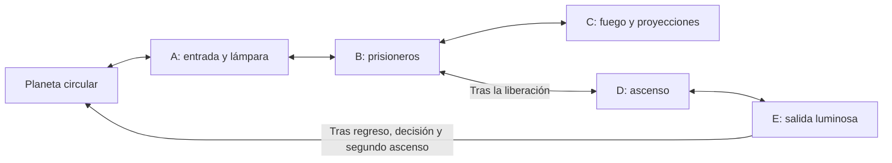

# La caverna de Platón: aventura en datos

La petición del autor se conserva en [AVENTURA-CAVERNA-SOLICITUD.md](AVENTURA-CAVERNA-SOLICITUD.md). Su nueva secuencia sustituye el final anterior al llegar por primera vez al exterior. Se conserva el prototipo antiguo, sus fondos y guardados; el planeta canónico usa ahora `public/worlds/plato.json` con el mismo motor configurable que los otros autores.

## Recorrido

1. Toca a Platón para conocer el problema de la caverna. No se abre automáticamente al aterrizar.
2. Entra al escenario A y busca la linterna física. Recógela, consérvala en Inventario y regresa a la superficie para conversar de nuevo con Platón. La antorcha sigue siendo opcional. Con su permiso, vuelve a A y enciende la linterna para poder seguir hacia B. La herramienta no se obtiene por leer el pensamiento inicial.
3. Conversa con el prisionero. En C examina el fuego y las figuras de caballo y humana; puedes examinar también la vasija. Toca después la zona del muro a la derecha para relacionar luz, objetos y proyecciones. No hay un cuestionario ni una respuesta moral puntuada.
4. Regresa a B. Presenta lo descubierto y escucha al prisionero. Cuando acepte, toca las cadenas junto a él. Su identidad se mantiene; cambia de aparición estática a compañero animado.
5. El camino del ascenso está en la zona central de B. Sube por D y alcanza E. El primer encuentro en la luz explica la adaptación y el sentido educativo del ascenso. Todavía no puedes cerrar la misión.
6. Regresa por D a B para escuchar las objeciones de los demás. Toca al compañero para hablar en privado y elegir: quedarse para ayudar o volver contigo al exterior. Ningún desenlace se puntúa como incorrecto; se identifica expresamente como adaptación narrativa del juego.
7. Recorre de nuevo D hasta E. Sofía sube sola si él se queda; en el otro caso la acompaña. Cerca de Platón se desarrolla el cierre. La salida del extremo derecho de E devuelve al punto de entrada del planeta; se completa la aventura y se habilita la siguiente etapa de Historia. La nave puede utilizarse desde la superficie antes de completar las misiones para volver a la Tierra.

El prisionero que se queda permanece en B; el que sale permanece en E tras el cierre. Ninguno acompaña por el universo. Las salidas de habitación se recorren tocando sus puertas, sin usar un botón que omita el camino; el regreso temprano desde A al planeta sigue disponible; abandonar el planeta requiere completar la aventura.

## Controles y presentación

Tocar/clicar el suelo dirige a Sofía. Tocar un personaje, objeto o zona ilustrada acerca e investiga. El círculo de mensaje indica conversaciones. Flechas/A-D y E/Enter siguen como alternativa; el joystick discreto permite movimiento táctil. No hay saltos obligatorios.

En los bocadillos no aparecen botones «Mostrar texto», «Continuar» o «Volver al camino». Un toque o Enter completa el texto y un segundo toque avanza. Solo se muestran botones cuando existen alternativas; Tab y Enter permiten elegirlas. Los menús y formularios del editor conservan sus controles.

## Configuración reutilizable

- `Dialogue.entries`: selecciona el primer turno según `requires` y `excludes`. Un cursor guardado conserva el turno ya empezado. Cada entrada y rama debe tener salida.
- `Interior.events`: encuentros narrativos explícitos dentro de un tramo `from`–`to`, con condiciones y un comportamiento existente. Solo se registran como vistos al completar la cadena.
- `Instance.visibleWhen`: apariciones condicionadas, sin duplicar identidades.
- `Interior.lighting`: oscuridad, bandera de lámpara, luces fijas opcionales y transición gradual hacia una oscuridad final. La luz usa una capa sobre el mundo, por debajo del HTML de diálogos y controles; no genera variantes de los fondos.
- `journey.companion`: identidad, escenas, comportamiento de conversación y condiciones del seguimiento. Reutiliza los fotogramas y el controlador de acompañamiento existentes.
- `journey.completionFlag`: finalización de la aventura y requisito de la siguiente etapa de Historia; no bloquea la nave en la superficie. `physicalDoors` exige usar las puertas del escenario y regresar a la superficie antes del viaje. Al reanudar una caverna en curso desde el mapa se conserva la habitación; una llegada nueva desde el universo mantiene la animación de la nave. Las puertas de la caverna se regulan mediante los requisitos normales de las interacciones.
- `Region.bottom`: descanso inferior de un tramo de escalera. Si falta, se utiliza el suelo principal, conservando los escenarios anteriores. Permite unir varios desniveles de manera continua.

Los cinco interiores tienen rejilla 1280×720, fondos originales 1920×1080 y suelo principal Y=560. Los apoyos se definen manualmente. En D se indican los descansos y los dos tramos; un pequeño paso con el recurso de piedra existente salva la discontinuidad de la ilustración sin exigir saltar. Este elemento sigue siendo provisional.

El editor conserva todos estos datos al guardar y exportar el mundo. Las conversaciones y sus vínculos se editan visualmente. Iluminación, eventos y condiciones avanzadas se ajustan en el JSON validado. No hay minijuegos independientes nuevos.

## Progreso y compatibilidad

Estados principales: `sombras_comprendidas`, `prisionero_liberado`, `primer_ascenso_completado`, `regreso_caverna_completado`, `decision_final_prisionero`, `segundo_ascenso_completado` y `aventura_platon_completada`. Se añaden las decisiones `prisionero_se_queda` o `prisionero_sale` y los descubrimientos de investigación e iluminación.

La ruta de Historia exige ahora `aventura_platon_completada` para abrir la siguiente etapa. Los perfiles que ya completaron el prototipo conservan su desbloqueo mediante `legacyCompletionFlags`; no se borra su partida. «Empezar de nuevo» permite probar la aventura desde cero con la confirmación habitual.

El descriptor anterior se conserva en `docs/prototipos/plato-descriptor-anterior.json`. Los escenarios clásicos de `main.ts` y las claves de la partida antigua permanecen. Los borradores antiguos del descriptor, sin interiores, se combinan con la nueva aventura conservando sus diálogos editados. Los borradores completos de mundos conservan su definición.

Pruebas: `npm test`, `npm run build` y `npm run test:plato-adventure`. Las comprobaciones táctiles automatizadas son emulación de Chrome, no una prueba en teléfono físico.

La sala C tiene ahora una salida por el arco pintado a la derecha (`fuego-ascenso`). Exige `prisionero_liberado`; quien ya va acompañado puede cruzar directamente hacia D. Antes de cumplirlo se indica regresar a liberar al prisionero. El acceso anterior desde B se conserva. D regresa por el historial: si se llegó desde C, vuelve a C en el punto del arco. Para el regreso narrativo obligatorio se continúa hacia B por la salida izquierda de C. Los borradores anteriores reciben el acceso mediante `plato-compatibility.ts`.

La sala B utiliza ahora un fondo sin fuego visible y apariencias encadenadas animadas antes de la liberación. Arte, estados, personalización y límites: [Prisioneros, arte y estados](PRISIONEROS-ARTE-Y-ESTADOS.md).

La introducción vigente se describe en [INTRODUCCION-PLATON-IMPLEMENTACION.md](INTRODUCCION-PLATON-IMPLEMENTACION.md). «lampara_encendida» conserva su ID histórico como adquisición; el estado real de luz es `equipment:lamp:on`. El escenario 1 permanece accesible durante la búsqueda.
