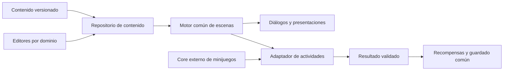

# Evolución modular y trabajo acotado

Auditoría local del 22 de noviembre de 2026. El proyecto usa Phaser 3, TypeScript y Vite. Ya hay módulos reutilizables; todavía no hay un SDK estable de extensiones.

## Lo que ya está separado

- Mundos: `worlds/schema.ts`, catálogo, generador, JSON en `public/worlds/`, recursos y progreso por ID. Un único motor radial y un controlador lateral compartido.
- Conversaciones: `content-player.ts`, `dialogue-stage.ts`, `dialogue-pages.ts`, `engine-settings.ts` y `dialogue-editor.ts`. Los grafos y la apariencia son datos compartidos.
- Actividades: `activity-editor.ts`, tipos validados y evaluación en `progression.ts`. Parejas, clasificación, preguntas y decisiones comparten recompensas.
- Partidas y rutas: `play-session.ts`, `save-library.ts`, `start-menu.ts` y `core-workbench.ts`. Las pruebas del editor no escriben progreso jugado.

## Dónde está el acoplamiento real

Medido antes del cambio de presentación: `main.ts` tiene unos 83 KB, `universe.ts` 68 KB, `planet-scene.ts` 27 KB y `core-workbench.ts` 21 KB. Su número de líneas es engañoso: hay líneas de 1.400–4.100 caracteres. Cuesta localizar una responsabilidad y revisar cambios pequeños.

`main.ts` mezcla arranque, puente Phaser/DOM, escenas laterales y compatibilidad antigua, controles, modal, viajes y formularios. `Universe` reúne carga/validación, navegación, progreso, atlas, importación, recursos y formularios del editor. `ContentPlayer` todavía combina avance y HTML de diálogo con presentación/evaluación de actividades. El editor importa utilidades desde ese reproductor. `WorldDefinition` conoce todos los tipos de actividad incorporados: no se puede añadir un core externo arbitrario sin un adaptador y validación.

El problema no se resuelve añadiendo React u otro framework. Tampoco hacen falta microservicios para un juego estático y offline. Necesitamos límites claros y menos responsabilidades en cada archivo.

## Orden de mejora, conservando el juego

1. Separar de `Universe` el repositorio de contenido: JSON publicado, borradores, recursos, importación/exportación. Interfaz de lectura/escritura y migraciones; no mover progreso al editor.
2. Extraer los formularios restantes a módulos de editor. `Universe` coordina y delega; los formularios no navegan por la partida. Reutilizar los actuales `saveAuthoring`, `configurePrimaryBehavior` y validadores.
3. Extraer escenas/compatibilidad lateral de `main.ts`; dejar un arranque que conecte servicios y puentes tipados. Sustituir `any` gradualmente, empezando por los puentes de escenas. Conservar las partidas antiguas.
4. Separar el avance del diálogo de sus presentaciones DOM; registro pequeño de presentaciones con la configuración global existente. No duplicar un sistema de mensajes por mundo.
5. Integrar el core externo de minijuegos mediante un adaptador explícito. El motor entrega una definición versionada y un contenedor; el adaptador monta/inicia/cancela/desmonta la actividad y devuelve un resultado. El motor común valida el resultado y aplica recompensas, flags y guardado. El minijuego no escribe el progreso global ni controla puertas directamente.
6. Antes de mover todo a paquetes npm, probar ese límite con el primer minijuego externo real. Mantener el adaptador en `src/engine/` al principio. Extraer paquetes cuando haya dos consumidores comprobados. No crear ahora una API ficticia para un core que todavía no se ha recibido.

## Regla para los cambios siguientes

- Cambio de contenido: JSON/recursos y validación. No tocar el motor si los contratos existentes bastan.
- Cambio de presentación: módulo de presentación y su prueba; puentes mínimos al motor. La introducción nueva vive en `engine/planet-introduction.ts`, habilitada por `surface.introduction`, sin condición por ID de Tierra.
- Cambio de contrato: adaptador, validación y prueba del límite; conservar el formato/lectura anterior mediante migración cuando corresponda.
- Verificar tipos y las pruebas de datos; elegir una prueba de navegador del flujo afectado. Recorrer toda la aventura solo si se cambia su lógica, geometría o continuidad. No repetir compilaciones completas sin un cambio nuevo que lo justifique.
- Usar Vite en desarrollo para iteraciones; producir `dist` una vez para revisar/publicar. Documentar el comando focal y el punto de entrada; no leer todos los documentos históricos para un ajuste visual.
- Una extracción por cambio, con comportamiento conservado. Formatear el módulo que se extrae, sin mezclar una reformulación masiva con una funcionalidad.

La demora anterior no demuestra falta de frameworks. Influyeron la amplitud de algunos cambios, archivos coordinadores grandes y verificaciones completas repetidas. No hay medición histórica suficiente para atribuir cada minuto. El compromiso útil es acotar cambios y comprobaciones, no prometer un tiempo fijo.

## Lo hecho ahora y lo pendiente

Ahora: presentación de cámara aislada, contrato de datos validado, marca persistente por partida/mundo, tooltip no modal y despliegue estático preparado. No se reescribieron escenas ni se reemplazaron los cores existentes. Las extracciones y el adaptador externo descritos arriba son próximos trabajos, no capacidades ya terminadas.
