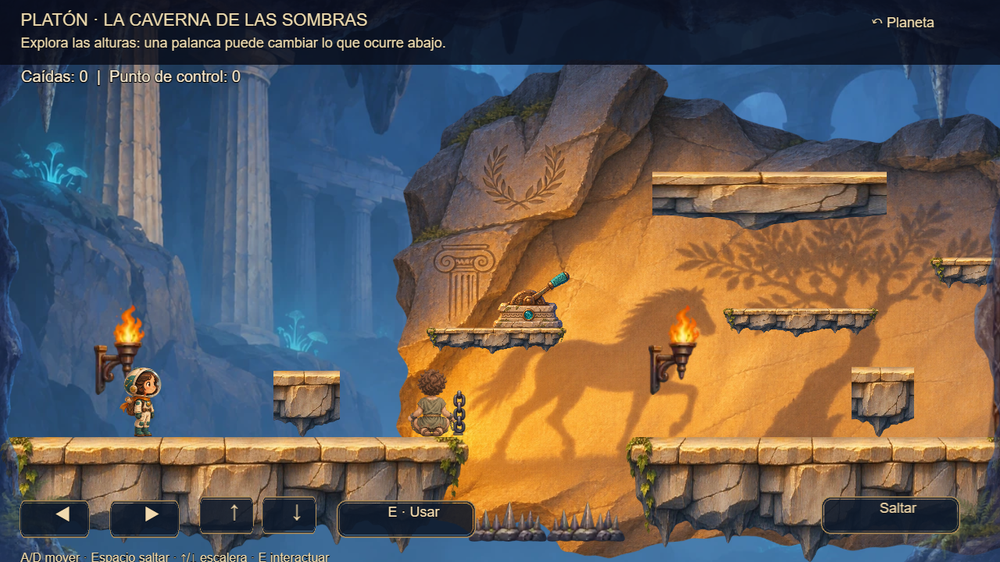
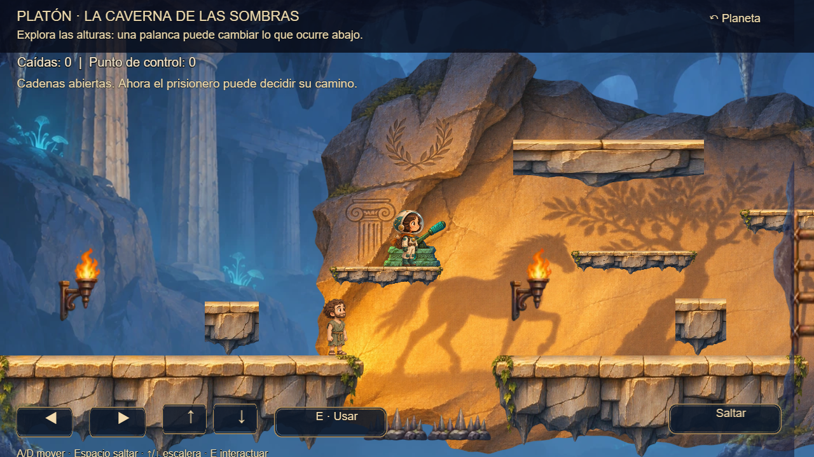

# Caverna ilustrada nativa — 27 de noviembre de 2026

Se modifica la plantilla existente `public/lab/gdevelop/plantilla-plataformas.json`. Se conservan sus ocho escenas y sus identificadores. Phaser y el prototipo `game.json` permanecen independientes.

## Diseño y autoría

Cinco recursos gráficos nuevos: caverna profunda, pared con sombras, primer plano transparente, plataforma modular y palanca de bronce. Los PNG maestros están en `art-source/gdevelop-caverna-v3`; el juego usa WebP optimizados en `assets/caverna-v3`. La roca de muro deriva de la plataforma; la placa de botones es una pieza simple de interfaz.

`Laboratorio_Mundo_Sombras` recibe el acabado completo. `Plantilla_Plataformas_Nativas` comparte fondo, plataformas, interfaz y mecanismo. El planeta reutiliza la ilustración existente de Platón. No se sustituyen los suelos por detección desde una imagen ni se elimina el recorrido anterior.

El parallax se configura con variables de escena `ParallaxFondo`, `ParallaxPared`, `ParallaxFrente` y `AnchoMundo`. El suelo, los muros y las plataformas son sprites nativos con sus comportamientos físicos; las capas de ambiente no bloquean al jugador. Los controles y eventos anteriores se conservan. Se organiza la lista de objetos en personajes, física, rescate, arte, interfaz y biblioteca anterior.

El evento externo nativo `Mecanica_Rescate_Celda` conecta las instancias de palanca, prisionero y cadenas por `Clave`. Permite E, Enter, botón Usar y toque cercano de la palanca. `Radio` es editable. El rescate cambia el sprite del prisionero, oculta las cadenas y muestra un aviso temporal. Las claves diferentes no comparten rescate. El estado global dura entre escenas durante la ejecución y una nueva partida confirmada inicia otra sesión de rescates.

**No hay eventos JavaScript personalizados** en la plantilla. El autor trabaja con los objetos, variables, comportamientos y eventos visuales de GDevelop. [Guía para editar y duplicar](../public/lab/gdevelop/GUIA-CAVERNA-ILUSTRADA.md).

## Validación

- Exportación mediante el exportador nativo de vista previa GDevelop 5.6.287.
- Recorrido real: saltar un muro, aterrizar, saltar hasta la plataforma elevada y activar el mecanismo. Sin teletransportar a Sofía ni conceder progreso desde la prueba.
- Teclado y móvil horizontal con toque emulado: activación, cambio de sprite, cadenas ocultas, aviso que desaparece y regreso al planeta.
- Cámaras medidas con desplazamientos diferentes de fondo, pared y primer plano.
- Duplicación de instancias con otra clave: solo se libera el prisionero vinculado; comprobados Enter y Usar.
- Salir/reentrar conserva el rescate en la sesión.
- El planeta y la aventura original abren y responden al movimiento/salto, sin errores JavaScript.
- 136 pruebas existentes de Phaser y dos pruebas estructurales nuevas de la plantilla correctas. TypeScript y Vite compilados.

Informe reproducible: `public/lab/gdevelop/VALIDACION-CAVERNA.json`. Prueba de navegador: `tests/browser_gdevelop_cave.py`; usar `GDEVELOP_EXPORT_DIR` con la exportación de la escena. La prueba duplica instancias mediante la API nativa para comprobar las claves y realiza las activaciones con controles reales. Pruebas estructurales: `tests/gdevelop-native-template.test.mjs`.

No se ha probado un teléfono físico. El rescate nuevo no incorpora persistencia propia en disco/nube. El guion definitivo de cinco habitaciones, la animación dibujada de desencadenarse y el recorrido íntegro de actividades anteriores siguen fuera de esta mejora visual. No se presenta como una migración completa del juego de Phaser.

## Capturas del juego funcionando

