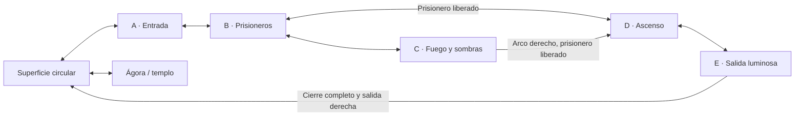

# Platón · Más allá de las sombras

> Documento de trabajo del mundo. Estado comprobado en el proyecto el **23 de noviembre de 2026**, antes de nuevas revisiones narrativas. No describe contenido futuro como terminado.

## Cómo usar este documento

Este archivo reúne el estado jugable, la experiencia de aprendizaje, las escenas, acciones y conversaciones. Las próximas propuestas de este mundo se desarrollarán aquí, distinguiendo **implementado**, **propuesto** y **aceptado pendiente de implementar**. Los demás mundos podrán tener su propio archivo en esta carpeta.

La fuente ejecutable es [plato.json](../../public/worlds/plato.json), ID permanente `plato`. Este documento no cambia automáticamente el juego: una modificación narrativa debe trasladarse a los datos y validarse. Los borradores guardados en el navegador tienen prioridad y pueden diferir de esta versión del repositorio; para incorporarlos hay que exportarlos e integrarlos.

## Resumen del estado implementado

- Motor común Phaser 3, TypeScript y Vite; mundo definido mediante JSON, sin motor exclusivo de Platón.
- Superficie circular recorrible, nave única, llegada animada y posibilidad de regresar a la Tierra sin completar la aventura, una vez de vuelta en la superficie.
- Cinco habitaciones de la caverna, A–E, más el interior del ágora/templo.
- Tres actos: investigación y liberación; primer ascenso y regreso; decisión del prisionero y segundo ascenso.
- El primer ascenso no termina la aventura. El regreso a B, la decisión y el segundo ascenso son necesarios para el cierre.
- Platón aparece en encuentros clave. El prisionero acompaña únicamente dentro de la caverna cuando corresponde; puede quedarse en B o terminar en E.
- Guardado por planeta y modo Historia/Libre, con continuidad de lámpara, descubrimientos y decisiones.
- Objetivos cumplidos tachados y marcados; aviso temporal del siguiente objetivo. Editor independiente de las partidas, con exportación/importación.

## Experiencia de aprendizaje

**Escuchar una creencia → investigar sus condiciones → contrastar → dialogar → acompañar el cambio → regresar y afrontar el rechazo → decidir y reflexionar.**

La investigación relaciona fuente de luz, objetos y proyecciones. La liberación requiere la aceptación del prisionero, no solo activar unas cadenas. La adaptación a la luz se presenta como gradual. El regreso plantea la dificultad de comunicar lo descubierto y escuchar a quienes mantienen sus creencias.

Los diálogos son recreaciones didácticas. La elección final de quedarse o salir es una adaptación narrativa del juego; no se califica como respuesta moral correcta o incorrecta. No se presenta como reproducción literal del texto de Platón ni como evaluación formal de aprendizaje. Actualmente no hay un minijuego independiente nuevo para la caverna: su actividad principal es explorar, relacionar observaciones, conversar y decidir.

## Geografía y recorrido real



El retorno desde D respeta el historial de puertas: si se entró desde C, se vuelve a C junto al arco. Para completar el regreso narrativo se continúa hasta B. No se teletransporta directamente de una habitación intermedia a la superficie; la entrada A permite salir temprano.

### Superficie

Sofía desembarca cerca de Platón. La presentación no se abre al aterrizar: se inicia al tocarlo o con la alternativa de teclado estando cerca. La nave sirve para viajar, la caverna conduce a A y el templo conduce al ágora. Hay elementos decorativos y coleccionables con sus comportamientos registrados más abajo. Un objeto decorativo no implica una actividad implementada.

### A · Entrada (`entrada`)

El pensamiento inicial de Sofía enciende su lámpara al terminar. Hay interacción directa con la lámpara y antorcha opcional. La iluminación sigue a Sofía y conserva oscuridad fuera de su foco. Se puede ir a B o volver a la superficie. Una recuperación compatible en B enciende la lámpara si falta en una partida anterior.

### B · Prisioneros (`prisioneros`)

Primera conversación con el prisionero, observación del muro y encuentro con otros prisioneros. Tras investigar C se vuelve a conversar, se obtiene su aceptación y se activan las cadenas. El mismo personaje pasa de encadenado a compañero. Existe acceso al ascenso tras liberarlo.

Después del primer ascenso, regresar físicamente aquí activa el conflicto con quienes rechazan lo descubierto. Luego se toca al compañero para decidir en privado si se queda para ayudar o vuelve al exterior. Si se queda, conserva una aparición estática en B con interacción de conversación.

### C · Fuego y sombras (`fuego`)

Se examinan fuego, caballo y figura humana; la vasija es una observación adicional. Relacionar las proyecciones exige haber examinado los tres primeros. La reflexión ramificada da paso a la comprensión de las sombras. Se regresa a B para continuar la liberación. El arco derecho permite pasar a D cuando el prisionero ya está liberado; el acceso desde B se conserva.

### D · Ascenso (`ascenso`)

Geometría manual de suelos, descansos y pendientes. Sofía y el compañero suben y bajan mediante el controlador común, sin saltos obligatorios. Hay un encuentro de adaptación durante el primer recorrido. Este espacio se recorre en ambos ascensos y en el regreso; no representa una misión terminada por sí solo.

### E · Salida (`salida`)

La primera llegada produce el encuentro de adaptación a la luz y registra el primer ascenso. Hay que regresar a B. Después de la decisión final, el segundo ascenso conduce al cierre con Platón. La salida del extremo derecho requiere la aventura completada y devuelve a la superficie. Quien decide salir permanece aquí tras el cierre; no acompaña por el universo.

### Ágora / templo (`agora`)

Interior accesible desde la superficie, con regreso, Platón y papiros. **Actualmente Platón reutiliza `arrival`, la presentación del mundo; no tiene todavía una conversación propia del ágora.** Los papiros muestran un examen breve sobre el espacio y la conservación del progreso. No hay una nueva misión independiente del templo.

## Objetivos exactos definidos

| Orden | Objetivo | Condición de cumplimiento | Instrucción actual |
|---|---|---|---|
| 1 | Una luz propia | `lampara_encendida` | Enciende la lámpara en la entrada. La antorcha es opcional. |
| 2 | Investigar antes de juzgar | `sombras_comprendidas` | Habla con el prisionero y examina el fuego, las figuras y la proyección en la sala C. |
| 3 | Salir por decisión propia | `prisionero_liberado` | Regresa a B, conversa con el prisionero y abre las cadenas cuando acepte. |
| 4 | El primer ascenso | `primer_ascenso_completado` | Acompaña al prisionero por D hasta la salida E. |
| 5 | Volver y escuchar | `regreso_caverna_completado` | Regresa físicamente por D hasta B y escucha el rechazo de los otros. |
| 6 | Respetar una decisión | `decision_final_prisionero` | Toca al compañero para conversar en privado: quedarse o volver al exterior. |
| 7 | El segundo ascenso | `segundo_ascenso_completado` | Recorre de nuevo D hasta E, con el prisionero o a solas. |
| 8 | Continuar el viaje | `aventura_platon_completada` | Finaliza la conversación de cierre y sal por el extremo derecho de E. Se completará la aventura y se abrirá la siguiente etapa de Historia. |

## Estado y decisiones del prisionero

| Momento | Estado / ubicación |
|---|---|
| Antes de liberarlo | Aparición encadenada en B; conversación condicionada por descubrimientos |
| Después de aceptar y abrir las cadenas | Acompaña en B, C, D y E |
| Primer exterior y regreso | Sigue acompañando; conversación sobre volver y encuentro de rechazo en B |
| Elige quedarse | Marca `prisionero_se_queda`; deja de seguir y permanece en B |
| Elige salir | Marca `prisionero_sale`; acompaña durante el segundo ascenso |
| Aventura completada | El seguimiento termina; queda en B o E según la decisión |

El seguimiento exige `prisionero_liberado` y se excluye con `prisionero_se_queda` o `aventura_platon_completada`. No hay acompañamiento fuera de esas cuatro habitaciones. Las conversaciones del compañero usan entradas condicionales; no dependen únicamente de contar cuántas veces se pulsa.

## Inventario por escena: objetos, acciones y encuentros

Los IDs permiten encontrar el elemento en el editor y el JSON. Las condiciones y cadenas de cada comportamiento se detallan en la sección siguiente. Los eventos listados son encuentros automáticos explícitos; el resto requiere interacción.

### Superficie · `surface`

| Elemento | ID | Comportamiento / interacción |
|---|---|---|
| ship | `ship` | `ship` |
| Platón | `philosopher` | `mentor` |
| Entrar al templo del ágora | `temple` | `entrar-agora` |
| tree | `olive-east` | `none` |
| scroll | `scroll` | `recoger-pergamino` |
| rock | `rocks-garden` | `none` |
| house | `house` | `none` |
| door | `door` | `observar-polis` |
| tree | `olive-cave` | `none` |
| Entrada a la caverna | `cave` | `entrada-caverna` |
| vase | `vase` | `recoger-anfora` |
| tree | `olive-west` | `none` |
| rock | `rocks-west` | `none` |
| scroll | `scroll-return` | `recoger-pergamino` |
| tree | `olive-landing` | `none` |
### A · Entrada de la caverna · `entrada`

| Elemento | ID | Comportamiento / interacción |
|---|---|---|
| Regresar al planeta | `entrada-planeta` | `entrada-planeta` |
| Seguir las voces hacia los prisioneros | `entrada-prisioneros` | `entrada-prisioneros` |
| Encender la lámpara de Sofía | `lampara-sofia` | `encender-lampara` |
| Encender la antorcha | `antorcha-entrada` | `encender-antorcha` |

- Evento `primer-pensamiento` → `evento-entrada`, tramo X=80–320. Requiere: sin requisitos adicionales. Se excluye con: ninguna marca adicional. Repetición: `once`.
### B · Sala de los prisioneros · `prisioneros`

| Elemento | ID | Comportamiento / interacción |
|---|---|---|
| Volver a la entrada | `prisioneros-entrada` | `prisioneros-entrada` |
| Investigar la sala del fuego | `prisioneros-fuego` | `prisioneros-fuego` |
| Camino del ascenso | `prisioneros-ascenso` | `prisioneros-ascenso` |
| El prisionero | `prisionero-encadenado` | `hablar-prisionero` |
| Conversar de nuevo con el prisionero | `prisionero-se-queda` | `hablar-prisionero` |
| Los otros prisioneros | `otros-encadenados` | `hablar-otros` |
| Abrir las cadenas | `cadenas-prisionero` | `liberar-cadenas` |
| Examinar la pared de sombras | `pared-proyecciones` | `mirar-pared` |

- Evento `recuperar-lampara` → `encender-lampara`, tramo X=0–1280. Requiere: sin requisitos adicionales. Se excluye con: `lampara_encendida`. Repetición: `once`.

- Evento `regreso-conflicto` → `regreso-dialogo`, tramo X=80–1250. Requiere: `primer_ascenso_completado`. Se excluye con: `regreso_caverna_completado`. Repetición: `once`.
### C · Fuego y sombras · `fuego`

| Elemento | ID | Comportamiento / interacción |
|---|---|---|
| Regresar con los prisioneros | `fuego-prisioneros` | `fuego-prisioneros` |
| Examinar la fuente de fuego | `objeto-fuego` | `examinar-fuego` |
| Examinar la figura de caballo | `objeto-caballo` | `examinar-caballo` |
| Examinar la vasija | `objeto-vasija` | `examinar-vasija` |
| Examinar la figura humana | `objeto-figura` | `examinar-figura` |
| Relacionar luz, objetos y proyección | `muro-proyeccion` | `comprender-sombras` |
| Arco hacia el ascenso | `fuego-ascenso` | `fuego-ascenso` |
### D · Camino del ascenso · `ascenso`

| Elemento | ID | Comportamiento / interacción |
|---|---|---|
| Regresar a la sala de los prisioneros | `ascenso-prisioneros` | `ascenso-prisioneros` |
| Alcanzar la salida luminosa | `ascenso-salida` | `ascenso-salida` |
| Paso de piedra del ascenso | `paso-piedra-visible` | `ninguno` |

- Evento `adaptacion` → `encuentro-ascenso`, tramo X=480–740. Requiere: `prisionero_liberado`. Se excluye con: `primer_ascenso_completado`. Repetición: `once`.
### E · Salida luminosa · `salida`

| Elemento | ID | Comportamiento / interacción |
|---|---|---|
| Volver por el ascenso | `salida-ascenso` | `salida-ascenso` |
| Salir de la caverna al planeta | `salida-planeta` | `salida-planeta` |
| Platón a la salida | `platon-salida` | `mentor` |
| El prisionero en libertad | `prisionero-libre-salida` | `hablar-prisionero` |

- Evento `primer-ascenso` → `primer-exterior`, tramo X=250–1250. Requiere: `prisionero_liberado`. Se excluye con: `primer_ascenso_completado`. Repetición: `once`.

- Evento `segundo-ascenso` → `segundo-exterior`, tramo X=850–1250. Requiere: `decision_final_prisionero`. Se excluye con: `aventura_platon_completada`. Repetición: `once`.
### Ágora · Templo de la Polis · `agora`

| Elemento | ID | Comportamiento / interacción |
|---|---|---|
| Salir del templo | `agora-entrada` | `agora-regresar` |
| Conversar con Platón | `agora-platon` | `agora-conversar` |
| Mesa de lectura | `agora-papiros` | `agora-leer` |

## Comportamientos y condiciones actuales

Se conservan aquí las cadenas exactas del descriptor, para distinguir qué diálogo abre una interacción, qué puerta conecta y qué recompensa registra. `requires` exige todas las marcas; `excludes` bloquea cuando corresponde. Las acciones se ejecutan en orden. Estos bloques son documentación, no instrucciones para ejecutar código.

### `mentor`
```json
{
  "actions": [
    {
      "type": "talk",
      "target": "arrival"
    }
  ]
}
```

### `evento-entrada`
```json
{
  "actions": [
    {
      "type": "talk",
      "target": "entrada-observacion"
    }
  ]
}
```

### `hablar-prisionero`
```json
{
  "actions": [
    {
      "type": "talk",
      "target": "prisionero"
    }
  ]
}
```

### `mirar-pared`
```json
{
  "actions": [
    {
      "type": "talk",
      "target": "pared-sombras"
    }
  ]
}
```

### `examinar-fuego`
```json
{
  "actions": [
    {
      "type": "talk",
      "target": "observar-fuego"
    }
  ]
}
```

### `examinar-caballo`
```json
{
  "actions": [
    {
      "type": "talk",
      "target": "observar-caballo"
    }
  ]
}
```

### `examinar-vasija`
```json
{
  "actions": [
    {
      "type": "talk",
      "target": "observar-vasija"
    }
  ]
}
```

### `examinar-figura`
```json
{
  "actions": [
    {
      "type": "talk",
      "target": "observar-figura"
    }
  ]
}
```

### `comprender-sombras`
```json
{
  "actions": [
    {
      "type": "talk",
      "target": "origen-sombras"
    }
  ],
  "requires": [
    "fuego_observado",
    "caballo_observado",
    "figura_observada"
  ],
  "blockedText": "Aún necesito observar el fuego, la figura de caballo y la figura humana antes de explicar las proyecciones."
}
```

### `liberar-cadenas`
```json
{
  "actions": [
    {
      "type": "activate",
      "text": "Las cadenas se abren. El mismo prisionero se incorpora, da sus primeros pasos y se coloca junto a Sofía.",
      "reward": {
        "flags": [
          "prisionero_liberado"
        ]
      }
    }
  ],
  "requires": [
    "prisionero_acepta"
  ],
  "blockedText": "Primero conversa con el prisionero y escucha si acepta salir contigo."
}
```

### `encuentro-ascenso`
```json
{
  "actions": [
    {
      "type": "talk",
      "target": "duda-ascenso"
    }
  ]
}
```

### `primer-exterior`
```json
{
  "actions": [
    {
      "type": "talk",
      "target": "primera-salida"
    }
  ]
}
```

### `regreso-dialogo`
```json
{
  "actions": [
    {
      "type": "talk",
      "target": "regreso-conflicto"
    }
  ]
}
```

### `hablar-companero`
```json
{
  "actions": [
    {
      "type": "talk",
      "target": "companero"
    }
  ]
}
```

### `segundo-exterior`
```json
{
  "actions": [
    {
      "type": "talk",
      "target": "cierre"
    }
  ]
}
```

### `entrada-caverna`
```json
{
  "actions": [
    {
      "type": "enter",
      "target": "entrada"
    }
  ]
}
```

### `entrada-planeta`
```json
{
  "actions": [
    {
      "type": "return"
    }
  ],
  "blockedText": "Este paso necesita que avances en la conversación y en lo que has descubierto. Consulta tus objetivos."
}
```

### `entrada-prisioneros`
```json
{
  "actions": [
    {
      "type": "enter",
      "target": "prisioneros"
    }
  ],
  "blockedText": "Sofía necesita encender su lámpara antes de seguir las voces.",
  "requires": [
    "lampara_encendida"
  ]
}
```

### `encender-lampara`
```json
{
  "actions": [
    {
      "type": "activate",
      "text": "La lámpara de Sofía está encendida. Su luz revela solo la zona que la rodea.",
      "reward": {
        "flags": [
          "lampara_encendida"
        ]
      }
    }
  ]
}
```

### `encender-antorcha`
```json
{
  "actions": [
    {
      "type": "activate",
      "text": "La antorcha queda encendida y su luz permanece aunque cambie de habitación.",
      "reward": {
        "flags": [
          "antorcha_entrada"
        ]
      }
    }
  ]
}
```

### `prisioneros-entrada`
```json
{
  "actions": [
    {
      "type": "return"
    }
  ],
  "blockedText": "Este paso necesita que avances en la conversación y en lo que has descubierto. Consulta tus objetivos."
}
```

### `prisioneros-fuego`
```json
{
  "actions": [
    {
      "type": "enter",
      "target": "fuego"
    }
  ],
  "requires": [
    "lampara_encendida"
  ],
  "blockedText": "Este paso necesita que avances en la conversación y en lo que has descubierto. Consulta tus objetivos."
}
```

### `prisioneros-ascenso`
```json
{
  "actions": [
    {
      "type": "enter",
      "target": "ascenso"
    }
  ],
  "requires": [
    "prisionero_liberado"
  ],
  "blockedText": "Este paso necesita que avances en la conversación y en lo que has descubierto. Consulta tus objetivos."
}
```

### `hablar-otros`
```json
{
  "actions": [
    {
      "type": "talk",
      "target": "otros-prisioneros"
    }
  ]
}
```

### `fuego-prisioneros`
```json
{
  "actions": [
    {
      "type": "return"
    }
  ],
  "blockedText": "Este paso necesita que avances en la conversación y en lo que has descubierto. Consulta tus objetivos."
}
```

### `ascenso-prisioneros`
```json
{
  "actions": [
    {
      "type": "return"
    }
  ],
  "blockedText": "Este paso necesita que avances en la conversación y en lo que has descubierto. Consulta tus objetivos."
}
```

### `ascenso-salida`
```json
{
  "actions": [
    {
      "type": "enter",
      "target": "salida"
    }
  ],
  "blockedText": "Este paso necesita que avances en la conversación y en lo que has descubierto. Consulta tus objetivos."
}
```

### `salida-ascenso`
```json
{
  "actions": [
    {
      "type": "return"
    }
  ],
  "blockedText": "Este paso necesita que avances en la conversación y en lo que has descubierto. Consulta tus objetivos."
}
```

### `salida-planeta`
```json
{
  "actions": [
    {
      "type": "surface"
    }
  ],
  "requires": [
    "aventura_platon_completada"
  ],
  "blockedText": "Este paso necesita que avances en la conversación y en lo que has descubierto. Consulta tus objetivos."
}
```

### `recoger-pergamino`
```json
{
  "actions": [
    {
      "type": "collect",
      "text": "Este pergamino recuerda una pregunta: ¿qué razones sostienen lo que damos por evidente?",
      "reward": {
        "flags": [
          "pergamino_encontrado"
        ]
      }
    }
  ]
}
```

### `recoger-anfora`
```json
{
  "actions": [
    {
      "type": "collect",
      "text": "Sofía conserva el recuerdo de esta ánfora: un objeto puede mostrarse de muchas maneras sin reducirse a una sola imagen."
    }
  ]
}
```

### `observar-polis`
```json
{
  "actions": [
    {
      "type": "examine",
      "text": "La Polis conserva sus lugares de encuentro. La entrada a la caverna está en la parte oscura del planeta. Los escenarios del prototipo anterior permanecen conservados."
    }
  ]
}
```

### `fuego-ascenso`
```json
{
  "requires": [
    "prisionero_liberado"
  ],
  "blockedText": "Antes de subir, regresa a la sala de los prisioneros y libera a quien aceptó acompañarte. Luego podéis cruzar este arco.",
  "actions": [
    {
      "type": "enter",
      "target": "ascenso"
    }
  ]
}
```

### `entrar-agora`
```json
{
  "actions": [
    {
      "type": "enter",
      "target": "agora"
    }
  ]
}
```

### `agora-regresar`
```json
{
  "actions": [
    {
      "type": "return"
    }
  ]
}
```

### `agora-conversar`
```json
{
  "actions": [
    {
      "type": "talk",
      "target": "arrival"
    }
  ]
}
```

### `agora-leer`
```json
{
  "actions": [
    {
      "type": "examine",
      "text": "Un espacio para leer y conversar. Puedes volver a la nave cuando quieras; tus descubrimientos y el avance de la caverna quedan guardados."
    }
  ]
}
```

## Conversaciones actuales: 15 conversaciones, 50 nodos

Esta transcripción procede del JSON del proyecto. El orden de los nodos en el archivo no obliga a recorrerlos todos: se sigue `start`, las entradas condicionales y el destino de cada respuesta. Los IDs se conservan para que podamos pedir correcciones precisas.

Una respuesta única llamada «Continuar» es una conexión interna; el juego avanza al tocar el bocadillo o pulsar Enter y no muestra ese botón auxiliar. Solo las decisiones/bifurcaciones muestran alternativas. Los estilos `parchment` y `ink` describen la presentación, no un cambio de historia.

### Primer encuentro con Platón · `arrival`

Inicio: `bienvenida`. Presentación: `parchment`.

#### `bienvenida` · Platón

Bienvenida, Sofía. En la caverna encontrarás personas que toman sombras por toda la realidad. Investiga con ellas antes de juzgarlas. Aprender también exige volver y escuchar.

- `seguir` — Continuar → fin de esta conversación.
### Encender la lámpara · `entrada-observacion`

Inicio: `oscuro`. Presentación: `parchment`.

Resultado al completar la conversación: `{"flags": ["lampara_encendida"]}`.

#### `oscuro` · Sofía

Aquí casi no se ve nada... ¿Quiénes vivirán en un lugar tan oscuro? Enciendo mi lámpara para investigar esas voces.

- `seguir` — Continuar → fin de esta conversación.
### Conversación con el prisionero · `prisionero`

Inicio: `pregunta`. Presentación: `parchment`.

Entradas según acontecimientos:
```json
[
  {
    "requires": [
      "prisionero_se_queda"
    ],
    "node": "se-queda"
  },
  {
    "requires": [
      "prisionero_liberado"
    ],
    "node": "libre"
  },
  {
    "requires": [
      "prisionero_acepta"
    ],
    "node": "espera"
  },
  {
    "requires": [
      "sombras_comprendidas"
    ],
    "node": "evidencias"
  }
]
```

#### `pregunta` · Sofía

¿Por qué permaneces mirando esa pared?

- `escuchar` — Continuar → `pared`.

#### `pared` · El prisionero

Porque allí está todo lo que conocemos. No necesitamos buscar otra realidad.

- `detras` — ¿Nunca has pensado que podría existir algo detrás de las sombras? → `duda`.

- `certeza` — ¿Cómo sabes que las sombras son todo lo que existe? → `certeza`.

#### `duda` · El prisionero

¿Detrás? ¿Qué podría existir más allá de la realidad? Tengo miedo de abandonar lo conocido.

- `investigar` — Investigaré qué produce esas figuras. → fin de esta conversación.

#### `certeza` · El prisionero

Siempre las hemos visto y todos les damos los mismos nombres. Nunca había pensado en pedir una explicación distinta.

- `seguir` — Continuar → fin de esta conversación.

#### `evidencias` · Sofía

Encontré un fuego y objetos que interrumpen su luz. La pared muestra proyecciones, no los objetos mismos.

- `mostrar` — Puedo mostrarte cómo cambian las sombras. → `aceptar`.

- `escuchar-miedo` — ¿Qué te asusta de comprobarlo? → `miedo`.

#### `miedo` · El prisionero

Si tienes razón, tendría que revisar todo lo que creía. Y la luz me duele.

- `acompanar` — No hace falta comprenderlo todo de una vez. Iré contigo. → `aceptar`.

#### `aceptar` · El prisionero

Quiero intentarlo. Abre mis cadenas y caminemos despacio.

- `consentir` — Continuar → fin de esta conversación. Resultado: `{"flags": ["prisionero_acepta"]}`.

#### `espera` · El prisionero

Estoy dispuesto. Puedes abrir las cadenas junto a mí. No quiero que me arrastres: iremos juntos.

- `seguir` — Continuar → fin de esta conversación.

#### `se-queda` · El prisionero

He decidido quedarme para seguir conversando con ellos. No puedo obligarlos a creerme, pero puedo acompañar sus preguntas.

- `seguir` — Continuar → fin de esta conversación.

#### `libre` · El prisionero

Ya no confundo la pared con todo lo real. Lo aprendido todavía me plantea preguntas.

- `seguir` — Continuar → fin de esta conversación.
### Lo que vemos en la pared · `pared-sombras`

Inicio: `mirar`. Presentación: `parchment`.

#### `mirar` · Sofía

Esas figuras cambian cuando algo se mueve detrás de la pared. Seguiré el recorrido de la luz para comprender por qué.

- `seguir` — Continuar → fin de esta conversación.
### El fuego detrás de las sombras · `observar-fuego`

Inicio: `observar`. Presentación: `parchment`.

Resultado al completar la conversación: `{"flags": ["fuego_observado"]}`.

#### `observar` · Sofía

Esta fuente de luz permite que aparezcan las sombras. Sin conocerla, la pared parece explicar todo por sí sola.

- `seguir` — Continuar → fin de esta conversación.
### La figura del caballo · `observar-caballo`

Inicio: `observar`. Presentación: `parchment`.

Resultado al completar la conversación: `{"flags": ["caballo_observado"]}`.

#### `observar` · Sofía

La figura de caballo tiene contorno y volumen. Su sombra depende de la posición del objeto y de la luz.

- `seguir` — Continuar → fin de esta conversación.
### La figura de la vasija · `observar-vasija`

Inicio: `observar`. Presentación: `parchment`.

Resultado al completar la conversación: `{"flags": ["vasija_observada"]}`.

#### `observar` · Sofía

Esta vasija no es la mancha oscura de la pared. Puedo rodearla y observar aspectos que su proyección no muestra.

- `seguir` — Continuar → fin de esta conversación.
### La figura humana · `observar-figura`

Inicio: `observar`. Presentación: `parchment`.

Resultado al completar la conversación: `{"flags": ["figura_observada"]}`.

#### `observar` · Sofía

La figura humana se interpone entre el fuego y el muro. Puedo seguir la relación entre objeto, luz y proyección.

- `seguir` — Continuar → fin de esta conversación.
### Descubrir el origen de las sombras · `origen-sombras`

Inicio: `hallazgo`. Presentación: `ink`.

Resultado al completar la conversación: `{"flags": ["sombras_comprendidas"]}`.

#### `hallazgo` · Sofía

¡Ahora entiendo! Lo que ellos ven son sombras de estos objetos. Comprender su origen exige relacionar la luz, las figuras y la pared.

- `pensar` — Continuar → `persuadir`.

#### `persuadir` · Sofía

Si alguien solo ha visto sombras durante toda su vida, ¿cómo podría invitarlo a investigar?

- `imponer` — Decirle que siempre estuvo equivocado. → `imponer`.

- `demostrar` — Mostrarle cómo se produce una sombra. → `demostrar`.

- `escuchar` — Escuchar su miedo y explorar juntos. → `escuchar`.

#### `imponer` · Sofía

Una afirmación tajante puede provocar rechazo. Necesitaré ofrecer razones y darle tiempo para examinar lo que digo.

- `seguir` — Continuar → fin de esta conversación.

#### `demostrar` · Sofía

Una experiencia compartida puede abrir preguntas. Ver algo distinto tampoco sustituye el esfuerzo de comprenderlo.

- `seguir` — Continuar → fin de esta conversación.

#### `escuchar` · Sofía

Escuchar no elimina las diferencias, pero permite buscar juntos las razones de nuestras creencias.

- `seguir` — Continuar → fin de esta conversación.
### La dificultad del ascenso · `duda-ascenso`

Inicio: `duele`. Presentación: `parchment`.

#### `duele` · El prisionero

La luz me lastima. Quiero regresar.

- `responder` — Continuar → `respuesta`.

#### `respuesta` · Sofía

Es normal que algo desconocido resulte difícil. ¿Quieres continuar?

- `paso` — Podemos detenernos y seguir paso a paso. → `paso`.

- `razones` — Recordemos lo que pudimos comprobar juntos. → `razones`.

#### `paso` · El prisionero

Sí. No necesito acostumbrarme de inmediato. Quiero dar el siguiente paso contigo.

- `seguir` — Continuar → fin de esta conversación.

#### `razones` · El prisionero

Las sombras dependían de cosas que antes no conocía. Seguiré, aunque todavía tenga dudas.

- `seguir` — Continuar → fin de esta conversación.
### Primera llegada a la luz · `primera-salida`

Inicio: `deslumbrado`. Presentación: `parchment`.

Resultado al completar la conversación: `{"flags": ["primer_ascenso_completado"]}`.

#### `deslumbrado` · El prisionero

La claridad me deslumbra. Primero puedo distinguir sombras y reflejos; después, poco a poco, los objetos.

- `adaptarse` — Continuar → `pregunta`.

#### `pregunta` · Sofía

¿Y ahora qué piensas de las sombras que observabas?

- `escuchar` — Continuar → `respuesta`.

#### `respuesta` · El prisionero

Creía que eran toda la realidad. Nunca imaginé que existiera algo así.

- `comprender` — Continuar → `educacion`.

#### `educacion` · Sofía

El ascenso representa también un cambio en nuestra manera de pensar y justificar lo que creemos. Conocer no consiste simplemente en contemplar un paisaje bonito.

- `volver` — Continuar → `regreso`.

#### `regreso` · El prisionero

Quiero volver con mis compañeros y compartir lo que he aprendido. ¿Recorremos de nuevo el camino?

- `seguir` — Continuar → fin de esta conversación.
### El rechazo al volver a la caverna · `regreso-conflicto`

Inicio: `contar`. Presentación: `ink`.

Resultado al completar la conversación: `{"flags": ["regreso_caverna_completado"]}`.

#### `contar` · El prisionero

He visto un mundo fuera de esta caverna. Lo que observamos aquí son sombras.

- `escuchar` — Continuar → `rechazo`.

#### `rechazo` · Otro prisionero

¡Imposible! Todo cuanto existe está frente a nosotros. La luz te ha confundido; ya ni siquiera reconoces nuestras sombras.

- `explicar` — Sofía: podemos mostrarles el fuego y las figuras. → `explicar`.

- `preguntar` — Sofía: ¿qué observación les haría revisar su creencia? → `preguntar`.

- `respetar` — Sofía: no vamos a obligarlos a acompañarnos. → `respetar`.

#### `explicar` · Otro prisionero

No quiero abandonar lo que conozco. Tus explicaciones no me convencen.

- `reflexionar` — Continuar → `privado`.

#### `preguntar` · Otro prisionero

No necesito esa prueba. Los nombres que damos a las sombras nos han bastado siempre.

- `reflexionar` — Continuar → `privado`.

#### `respetar` · Otro prisionero

Entonces déjennos mirar nuestra pared.

- `reflexionar` — Continuar → `privado`.

#### `privado` · Sofía

Compartir una experiencia no garantiza que los demás la acepten. Podemos ofrecer razones y escuchar sus objeciones, pero no decidir por ellos. Hablemos en privado sobre lo que deseas hacer.

- `seguir` — Continuar → fin de esta conversación.
### El camino con el prisionero · `companero`

Inicio: `caminar`. Presentación: `parchment`.

Entradas según acontecimientos:
```json
[
  {
    "requires": [
      "decision_final_prisionero"
    ],
    "node": "segunda-vez"
  },
  {
    "requires": [
      "regreso_caverna_completado"
    ],
    "node": "decidir"
  },
  {
    "requires": [
      "primer_ascenso_completado"
    ],
    "node": "volver"
  }
]
```

#### `caminar` · El prisionero

Iré a tu lado. Podemos conversar cuando quieras y avanzar sin apresurarnos.

- `seguir` — Continuar → fin de esta conversación.

#### `volver` · El prisionero

Debemos regresar por el ascenso hasta la sala de mis compañeros. Aún no hemos terminado.

- `seguir` — Continuar → fin de esta conversación.

#### `decidir` · Sofía

Ahora conoces la luz, pero tus compañeros no quieren escucharte. ¿Qué deseas hacer?

- `quedarse` — Permanecer en la caverna e intentar ayudarlos. → `quedarse`.

- `exterior` — Regresar al exterior con Sofía. → `exterior`.

#### `quedarse` · El prisionero

Me quedaré. No puedo forzar su decisión, pero quiero estar aquí si comienzan a preguntar.

- `respetar` — Continuar → `despedida`. Resultado: `{"flags": ["decision_final_prisionero", "prisionero_se_queda"]}`.

#### `despedida` · Sofía

Respeto tu decisión. Subiré de nuevo para continuar mi viaje. Esta elección es nuestra adaptación narrativa; no es un desenlace que Platón describiera literalmente.

- `seguir` — Continuar → fin de esta conversación.

#### `exterior` · El prisionero

Volveré al exterior contigo. Podemos seguir aprendiendo sin dejar de preguntarnos cómo ayudar a los demás.

- `seguir` — Continuar → `juntos`. Resultado: `{"flags": ["decision_final_prisionero", "prisionero_sale"]}`.

#### `juntos` · Sofía

Hagamos el segundo ascenso. Esta elección es una adaptación de nuestra aventura, no un final literal del relato de Platón.

- `seguir` — Continuar → fin de esta conversación.

#### `segunda-vez` · El prisionero

He decidido subir de nuevo contigo. Esta vez conozco el camino, aunque aprender no haya terminado.

- `seguir` — Continuar → fin de esta conversación.
### La decisión y el segundo ascenso · `cierre`

Inicio: `sola`. Presentación: `parchment`.

Entradas según acontecimientos:
```json
[
  {
    "requires": [
      "prisionero_sale"
    ],
    "node": "juntos"
  }
]
```

Resultado al completar la conversación: `{"flags": ["segundo_ascenso_completado", "aventura_platon_completada"]}`.

#### `sola` · Sofía

He recorrido por segunda vez el ascenso. Mi compañero eligió quedarse para ayudar; yo continúo con lo aprendido.

- `pensar` — Continuar → `platon`.

#### `juntos` · El prisionero

Hemos subido de nuevo. Ahora sé que revisar lo que creemos requiere esfuerzo, y que explicarlo a otros también puede ser difícil.

- `pensar` — Continuar → `platon`.

#### `platon` · Platón

La educación no es poner visión en unos ojos ciegos: exige orientar la mirada y examinar las razones. El regreso plantea además qué responsabilidad tenemos ante los otros.

- `final` — Continuar → `final`.

#### `final` · Sofía

Investigué las sombras, acompañé el aprendizaje, regresé para escuchar el rechazo y respeté una decisión. Ahora puedo salir de la caverna y continuar el viaje.

- `seguir` — Continuar → fin de esta conversación.
### Quienes siguen mirando la pared · `otros-prisioneros`

Inicio: `pared`. Presentación: `parchment`.

#### `pared` · Otro prisionero

Todo cuanto necesitamos está en esa pared. No queremos abandonar nuestras sombras.

- `seguir` — Continuar → fin de esta conversación.

## Presentación, controles y persistencia

- Clic/toque en destino para caminar; tocar un objeto o personaje acerca a Sofía y realiza la interacción. El círculo de mensaje indica conversación disponible.
- Enter/toque completa el texto progresivo y luego avanza. Las alternativas no se eligen automáticamente. Se conserva teclado como alternativa.
- Diálogos paginados, sin crecimiento progresivo de la caja ni barra de desplazamiento para leer el parlamento.
- Sofía y los filósofos conservan altura visible y apoyo de pies. La cámara general del planeta es un cambio explícito de vista.
- Interiores en rejilla 1280×720 con suelo principal Y=560. Cambiar un fondo no redefine automáticamente sus colisiones. Los fondos importados del autor y sus apoyos están guardados en el descriptor.
- Progreso Historia/Libre independiente; diseños y recursos compartidos. El editor y sus pruebas no escriben progreso jugado.
- La finalización de la aventura habilita la siguiente etapa de Historia. No bloquea la nave en la superficie; desde una habitación hay que volver primero por sus accesos.

## Validación ya realizada y límites

Se han comprobado con pruebas de datos y navegador la investigación, lámpara persistente, liberación, primer ascenso, regreso, ambos desenlaces y segundo ascenso. También guardado/recarga, ausencia de compañero en el universo y continuidad de los pies en pendientes. Las pruebas táctiles son emulación de Chrome; no equivalen a una prueba en teléfono físico.

Las mejoras del editor se comprobaron aparte con clic, toque emulado, inserción única, confirmación de borrado, Deshacer/Rehacer y prueba de escenas. Esto no certifica que cada futura edición narrativa conserve una secuencia válida: hay que volver a comprobar las rutas modificadas.

No se inventaría contenido faltante: el ágora reutiliza actualmente la presentación; no hay minijuegos independientes nuevos ni una evaluación pedagógica formal. Los cambios locales del navegador solo quedan reflejados aquí cuando se integren en el repositorio.

## Ideas y próximas revisiones — todavía sin definir

Espacio reservado para el autor; ninguna de estas casillas describe trabajo ya aprobado:

- [ ] Revisar objetivos de aprendizaje y qué evidencia debe producir el jugador.
- [ ] Corregir intervenciones concretas indicando conversación y nodo.
- [ ] Definir si el ágora necesita una experiencia y diálogo propios.
- [ ] Revisar condiciones de reencuentro al volver a cada habitación.
- [ ] Diseñar actividades futuras y sus consecuencias antes de conectarlas al motor.

Para cada propuesta anotar: escena, situación previa, personaje, texto/opciones, acontecimiento producido, consecuencia posterior y estado de aprobación.

## Referencias del proyecto

- [Aventura y compatibilidad de la caverna](../CAVERNA-JUGABLE.md). Contiene notas históricas; ante afirmaciones antiguas sobre bloqueo de la nave, prevalecen las decisiones posteriores y los datos vigentes descritos aquí.
- [Decisiones de diseño](../DECISIONES-DE-DISENO.md).
- [Editor y acontecimientos](../EDITOR-Y-ACONTECIMIENTOS.md).
- [Validación del motor](../VALIDACION-MOTOR.md).
- [Auditoría de usabilidad del editor](../AUDITORIA-EDITOR.md).

## Historial de este documento

- **2026-11-23:** primera fotografía del estado del mundo a partir del descriptor del repositorio; incluye seis interiores, inventario de comportamientos, ocho objetivos y transcripción de las quince conversaciones. No cambia el contenido del juego.

